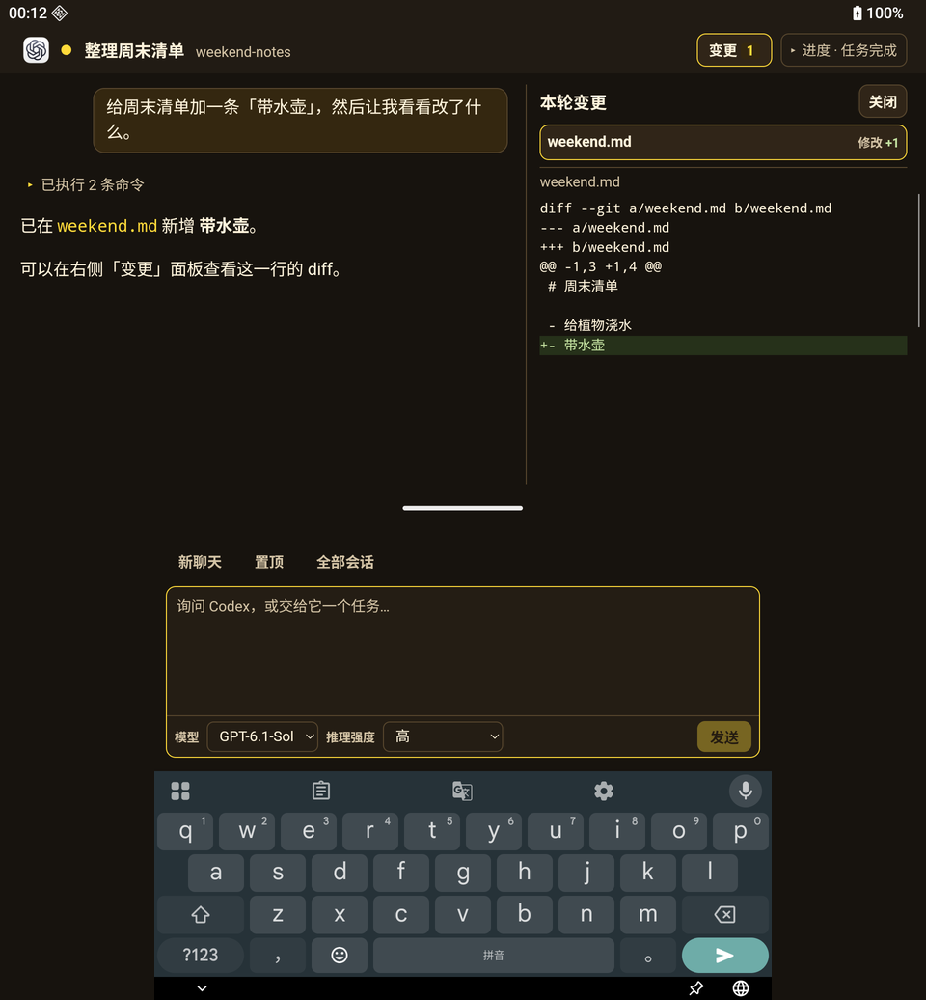
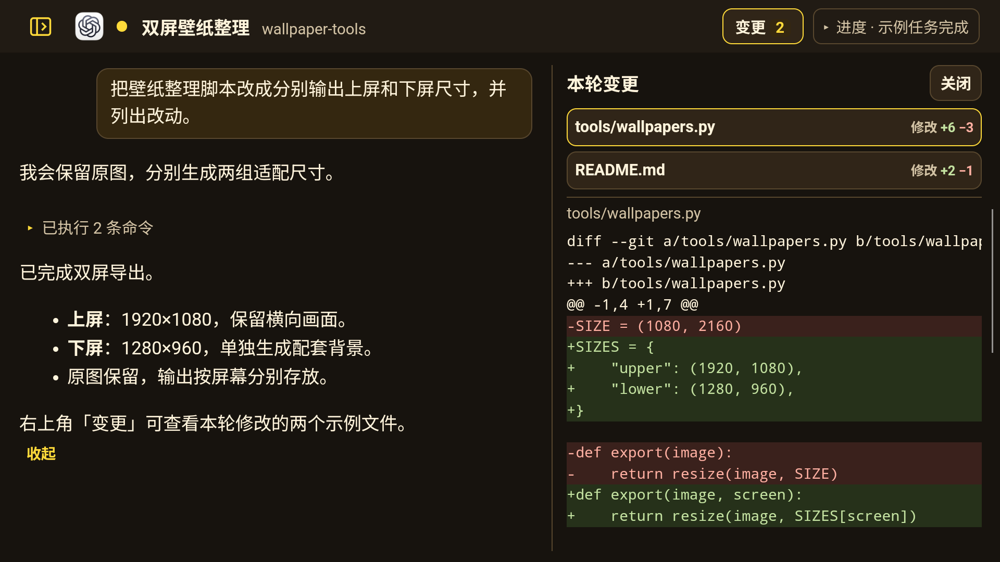
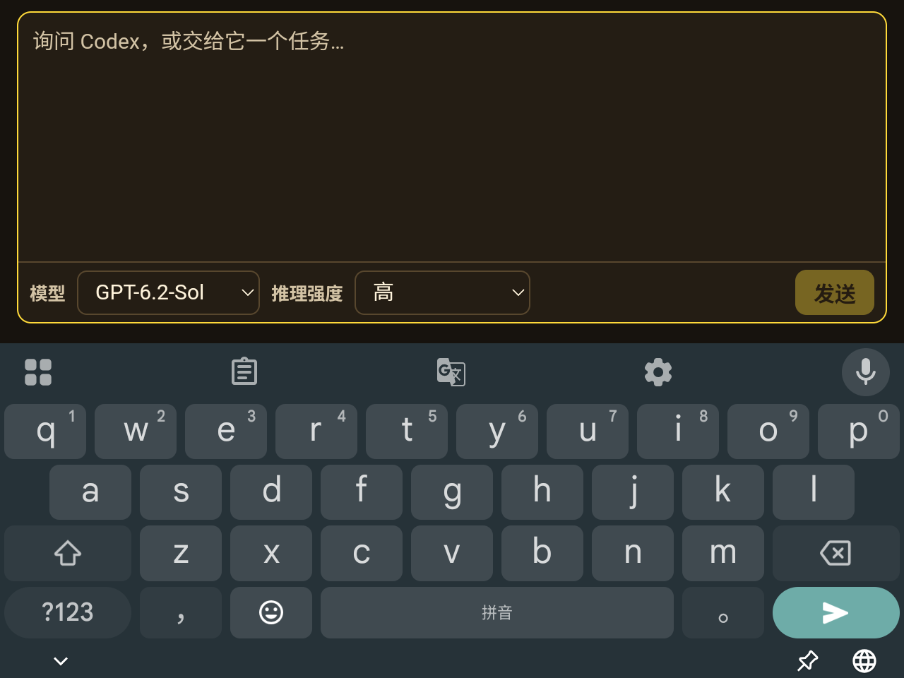
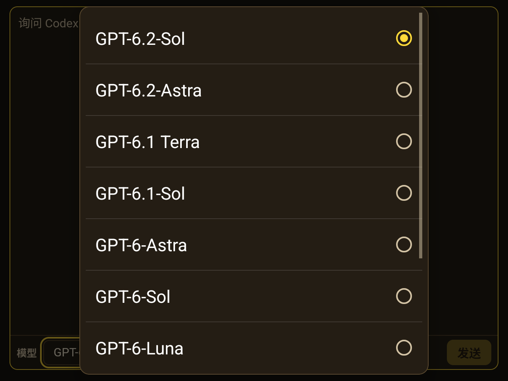

<div align="center">
  
  <h1>codex-remote-rp-duo</h1>
  <p>在 Retroid Pocket Duo 上，用双屏跟进 Mac 上的 Codex 任务。</p>
  <p><a href="#界面预览">界面预览</a> · <a href="#开始使用">开始使用</a> · <a href="docs/installation.md">安装指南</a> · <a href="docs/troubleshooting.md">排障</a> · <a href="https://github.com/xuruiray/codex-remote-rp-duo/releases">下载与版本</a></p>
</div>

**上屏看任务，下屏写消息。** 通过 USB 或同一局域网连接 Mac，使用 Mac 上已登录的 Codex 执行任务，无需另外配置 OpenAI API Key。

这是个人开发的非官方客户端，主要适配 **Retroid Pocket Duo**：上屏 1920×1080，下屏 1280×960。源码和 Release 均可公开访问。

## 能做什么

| 能力 | 使用方式 |
| --- | --- |
| 多会话并行 | 从「新聊天 / 置顶 / 全部会话」切换，原任务继续运行；停止只作用于当前会话。 |
| 专注阅读 | 上屏全屏显示回复、思考摘要和折叠命令；收起侧栏后对话铺满上屏。 |
| 查看变更 | 显示本轮变更文件数，逐个查看文件 diff。 |
| 回答 AI 提问 | 上屏点选答案，下屏填写自由回答并提交；支持等待作答的协议请求与普通提问卡片。 |
| 常驻输入 | 下屏保留输入框与键盘，选择模型和推理强度；支持按会话保存输入草稿。 |
| 会话管理 | 续聊、置顶、重命名、归档和恢复；接近历史顶部自动加载更早记录。 |
| 掌机操作 | 触屏、方向键上下及摇杆纵向滚动阅读区；主界面连续两次返回退出。 |

模型和推理选项由 Mac 的 Codex 组件及当前账号提供；所选模型支持「高」时默认选中「高」。

## 界面预览

以下均为掌机实拍截图，使用虚构会话、示例文件和测试内容。

| 上屏：会话与回复 | 上屏：文件变更 |
| --- | --- |
|  |  |

| 下屏：输入与常驻键盘 | 下屏：统一主题的模型菜单 |
| --- | --- |
|  |  |

[查看 AI 提问示例](docs/screenshots/questions.png) · [双屏操作说明](docs/usage.md)

## 开始使用

**首次换到自己的 Mac，请从源码构建。** 现有 Release APK 内嵌了构建时 Mac 的本地配对 CA，适用于对应配对环境，不能当作任意电脑下载即用的通用安装包。详见[首次安装与升级的区别](docs/installation.md)。

需要：macOS、已登录的 Codex、Python 3.11+、JDK 21、Android SDK Platform 36 / Build Tools 36.0.0、ADB 和支持所用证书命令的 OpenSSL。Android 的最低声明版本为 10，目前真机验证设备为 Retroid Pocket Duo。

完成[环境准备](docs/installation.md#环境准备)，并在掌机上启用 USB 调试、授权这台 Mac 后：

```sh
git clone https://github.com/xuruiray/codex-remote-rp-duo.git
cd codex-remote-rp-duo

./prepare-wifi.sh
./build-apk.sh
adb install -r DuoCodex.apk
./USB.command
```

首次配对后，Mac 与掌机在同一局域网时可拔掉 USB 使用。任务仍在 Mac 上运行，Mac 需要保持在线。

- [完整安装、首次配对与升级](docs/installation.md)
- [常用操作、连接模式与配置](docs/usage.md)
- [连接、证书、签名和键盘排障](docs/troubleshooting.md)
- [版本记录](CHANGELOG.md) · [APK 校验与发布流程](docs/releasing.md)

## 如何工作


Android 负责双屏、键盘和手柄输入；界面和会话接口由 Mac 桥接提供，任务交给本机 Codex app-server。详细职责见[架构与开发](docs/development.md)。

## 当前边界

- 连接方式为 USB 或同一局域网，未实现公网中继、多人账户体系或商店分发。
- 其他 Android 设备提供单屏布局回退，但未完成跨机型兼容性验证。
- 「思考摘要」来自协议公开的 summary，不是模型完整内部思考。
- 当前运行组件禁用了 apps、plugins、hooks 和配置中的 MCP servers，不能把模型列表一致理解为桌面工具能力完全一致。
- 很长的正文/命令输出会截断，Mac 子进程异常退出后的恢复仍需手动重启连接。更多细节见[已知限制](docs/troubleshooting.md#已知限制)。

## 开发与反馈

```sh
python3 -m unittest discover -s tests -v
python3 scripts/check-docs.py
```

CI 检查 Python 回归、Web JavaScript 语法、Shell 语法和文档本地链接。Android APK 构建与双屏真机验证按[开发说明](docs/development.md)执行。

提交问题前可先看[排障指南](docs/troubleshooting.md)，再使用 [Bug 反馈](https://github.com/xuruiray/codex-remote-rp-duo/issues/new?template=bug_report.yml)或[功能建议](https://github.com/xuruiray/codex-remote-rp-duo/issues/new?template=feature_request.yml)模板。贡献说明见 [CONTRIBUTING.md](CONTRIBUTING.md)。

项目尚未声明整体代码许可证；参考开源项目不代表本仓库已按某种开源协议授权。第三方代码与品牌说明见 [THIRD_PARTY_NOTICES.md](THIRD_PARTY_NOTICES.md)。仓库组织参考了 [Codex、scrcpy 和 Happy 的文档](docs/references.md)。
